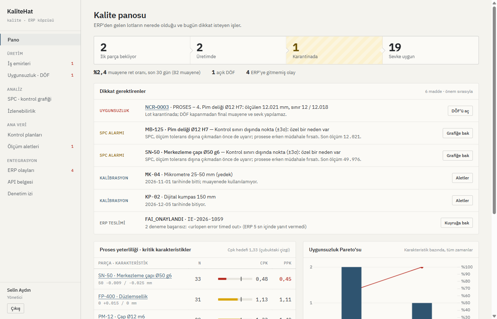
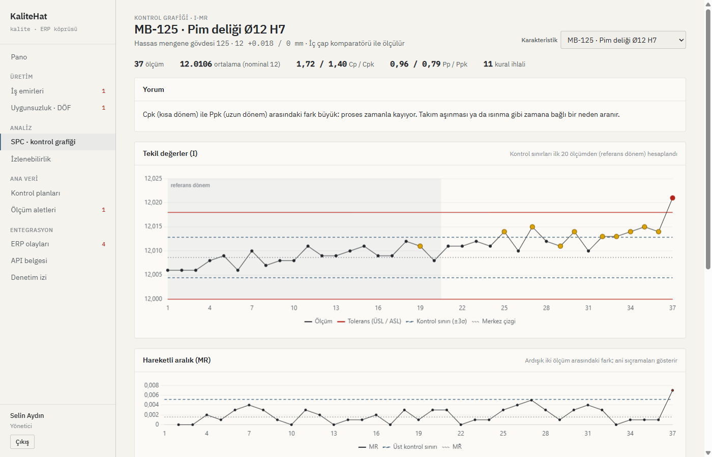
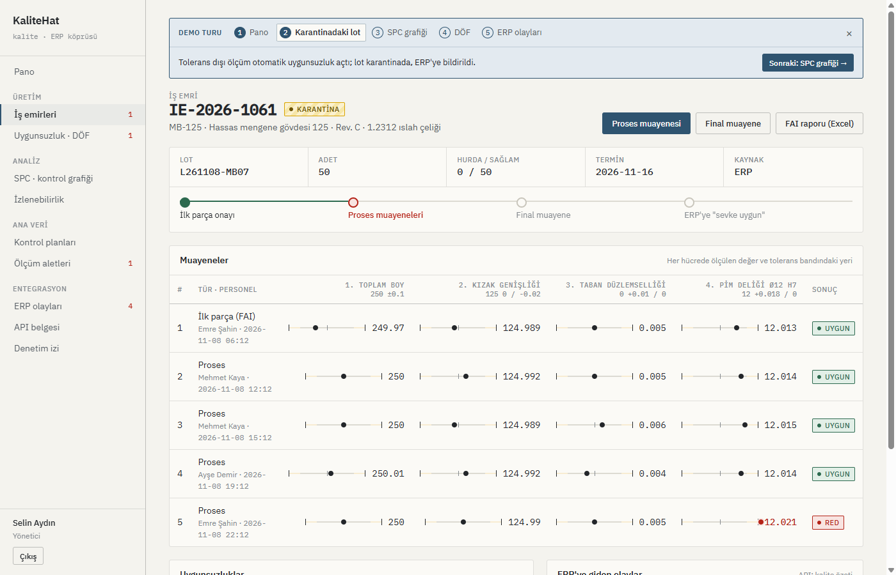
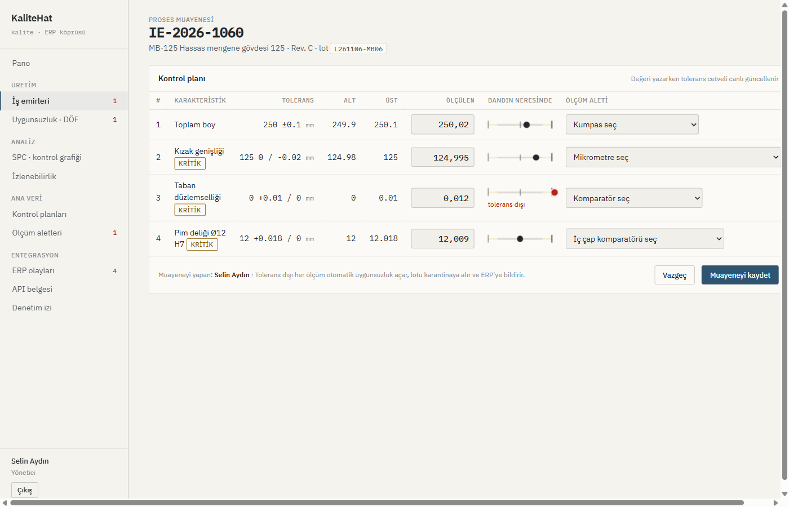
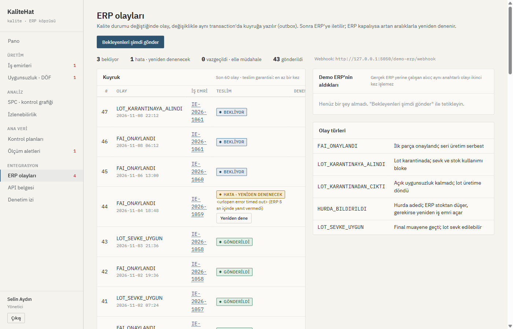
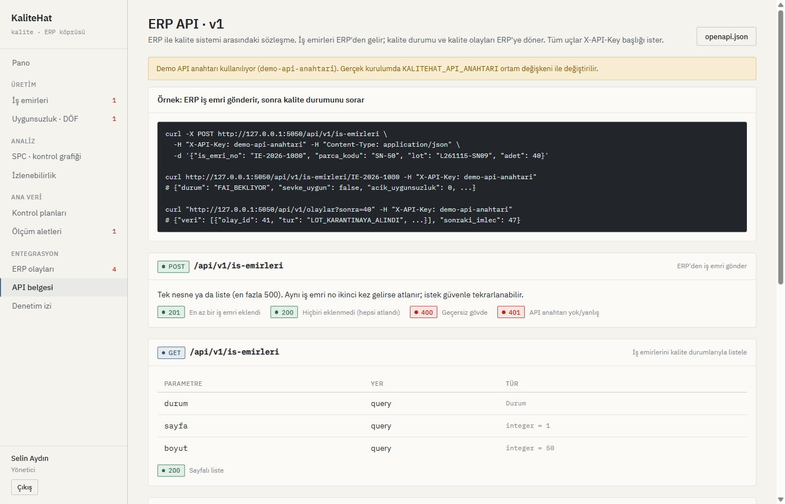

# KaliteHat

CNC talaşlı imalat atölyesi için **kalite kontrol + ERP köprüsü**. İş emirleri ERP'den gelir; ilk parça (FAI), proses ve final muayeneleri kontrol planına göre kaydedilir; tolerans dışı ölçüm otomatik uygunsuzluk (NCR) açar ve lotu karantinaya alır; kalite durumu her değiştiğinde ERP'ye olay olarak bildirilir.

AS9100 / ISO 9001 ortamında bir kalite biriminin günlük işini (ilk parça onayı, kalibrasyon kontrolü, DÖF, izlenebilirlik, SPC) ve bunun ERP ile konuşmasını tek uygulamada gösteren bir örnek projedir. Veriler tamamen kurgusaldır.

**▶ Canlı demo: [kalitehat.onrender.com](https://kalitehat.onrender.com)** · kullanıcı `selin`, parola `demo`. Ücretsiz sunucu uykudaysa ilk açılış 30-50 saniye sürebilir; veri her yeniden başlatmada sıfırlanır.



## Ne yapar

| Alan | Davranış |
|---|---|
| **İş emri girişi** | ERP'den REST API (`POST /api/v1/is-emirleri`) ya da CSV/XLSX dosyasıyla gelir. Aynı iş emri ikinci kez gelirse atlanır; istek güvenle tekrarlanabilir. |
| **Muayene** | Kontrol planındaki her karakteristik için ölçüm + ölçüm aleti. Kalibrasyonu geçmiş alet kayıtta reddedilir. Ölçüm yazılırken tolerans cetveli canlı gösterilir. |
| **Kalite kapısı** | İlk parça onaylanmadan proses/final muayene yapılamaz. Açık uygunsuzluk varken final muayene ve sevk yapılamaz. |
| **Uygunsuzluk · DÖF** | Tolerans dışı her ölçüm NCR açar, lot `KARANTINA` olur. DÖF kök neden + faaliyet + ürün kararı (yeniden işleme / sapma ile kabul / hurda) ile kapanır. |
| **SPC** | I-MR kontrol grafiği, Western Electric kuralları 1-3, Cp/Cpk ve Pp/Ppk. Ölçüm tolerans dışına çıkmadan önce kayma ve trendi yakalar. |
| **FAI raporu** | AS9102 Form 3 düzenine benzer Excel çıktısı. |
| **ERP'ye bildirim** | Durum değişikliği ile aynı transaction'da olay kuyruğa yazılır (transactional outbox). Webhook'a `Idempotency-Key` ile iletilir, hata olursa artan aralıklarla yeniden denenir. ERP isterse olayları imleçle kendisi de çekebilir. |
| **İzlenebilirlik** | Lot / iş emri / alet koduyla arama: hangi parça, hangi ölçüm, hangi aletle, kim ölçtü. |
| **Denetim izi** | Muayene, DÖF kapatma, kalibrasyon, içe aktarma gibi her kayıt kim/ne zaman/ne ile saklanır. |
| **Roller** | Operatör muayene girer; kalite DÖF kapatır, kalibrasyon yeniler, iş emri içe aktarır; yönetici entegrasyonu yönetir. |

## Hızlı başlangıç

Python 3.11+ gerekir.

```bash
pip install -r requirements.txt
python calistir.py          # ilk çalıştırmada demo verisini kurar
```

<http://127.0.0.1:5050> adresini açın. Demo kullanıcılar (parola `demo`):

| Kullanıcı | Rol |
|---|---|
| `mehmet`, `ayse`, `emre` | Operatör |
| `zeynep` | Kalite |
| `selin` | Yönetici |

Demo verisini sıfırlamak: `python -m kalitehat.ornek_veri`

Docker ile:

```bash
docker build -t kalitehat .
docker run -p 5050:5050 kalitehat
```

## Demo verisindeki hikâye

Örnek veri rastgele değil, iki gerçekçi sorun barındırır:

1. **Merkezleme ofseti (SN-50 · Ø50 g6):** Dağılım dar ama ortalama tolerans sınırına yakın. Cp 1,07 iken Cpk 0,48; sorun yayılım değil, ayar.
2. **Takım aşınması (MB-125 · Pim deliği Ø12 H7):** Çap her lotta biraz büyüyor. Kısa dönem Cpk 1,40, uzun dönem Ppk 0,79. SPC 19. ölçümde "9 nokta aynı tarafta" uyarısı verir; ölçüm ancak 37. noktada tolerans dışına çıkar ve son lot karantinaya düşer.



## ERP entegrasyonu

```
ERP ──POST /api/v1/is-emirleri──────────────▶ KaliteHat
ERP ◀──GET /api/v1/is-emirleri/{no}────────── (kalite durumu, sevke uygun mu)
ERP ◀──webhook: FAI_ONAYLANDI, LOT_KARANTINAYA_ALINDI, ... (outbox, en az bir kez)
ERP ──GET /api/v1/olaylar?sonra={imlec}─────▶ (webhook yerine çekme)
```

- Kimlik doğrulama: `X-API-Key` başlığı (`KALITEHAT_API_ANAHTARI`).
- Sözleşme: `GET /api/v1/openapi.json` (OpenAPI 3.0). Uygulama içinde "API belgesi" sayfası örnek `curl` komutlarını gösterir.
- Hata biçimi her uçta aynı: `{"hata": {"kod", "mesaj", "ayrinti"}}`.
- Webhook yapılandırılmamışsa uygulama içindeki **demo ERP** alıcısı kullanılır; aynı anahtarlı olayı ikinci kez işlemez.

```bash
curl -X POST http://127.0.0.1:5050/api/v1/is-emirleri \
  -H "X-API-Key: demo-api-anahtari" -H "Content-Type: application/json" \
  -d '{"is_emri_no": "IE-2026-1080", "parca_kodu": "SN-50", "lot": "L261115-SN09", "adet": 40}'
```

Gerçek bir ERP adresi tanımlıyken (`KALITEHAT_ERP_WEBHOOK`) bekleyen olayları zamanlanmış görevle göndermek için: `flask --app kalitehat olaylari-gonder`

## Yapılandırma

| Ortam değişkeni | Varsayılan | Açıklama |
|---|---|---|
| `KALITEHAT_DB` | `veri/kalitehat.db` | SQLite dosyası |
| `KALITEHAT_GIZLI_ANAHTAR` | rastgele | Oturum imzalama anahtarı (üretimde sabit verilmeli) |
| `KALITEHAT_API_ANAHTARI` | `demo-api-anahtari` | ERP'nin kullandığı API anahtarı |
| `KALITEHAT_ERP_WEBHOOK` | demo ERP | Olayların gönderileceği adres |
| `KALITEHAT_DEMO_ERP` | `1` | `0` ise demo ERP alıcısı ve giriş ekranındaki demo kullanıcı listesi kapanır; bu durumda `KALITEHAT_API_ANAHTARI` zorunludur |

## Proje yapısı

```
kalitehat/
  muayene.py      muayene kaydı, kalite kapısı, kalibrasyon kilidi
  dof.py          uygunsuzluk kapatma ve ürün kararı
  spc.py          I-MR, Cp/Cpk/Pp/Ppk, kural ihlalleri
  erp.py          iş emri içe aktarma, ERP'nin okuduğu kalite özeti
  olaylar.py      outbox, webhook gönderimi, yeniden deneme
  fai_rapor.py    FAI Excel raporu
  db.py           şema ve sürümlü geçişler (PRAGMA user_version)
  web/            arayüz, REST API, güvenlik (oturum, CSRF, roller)
tests/            iş kuralları, SPC, ERP, HTTP katmanı
docs/             mimari ve karar kayıtları
```

Ayrıntılar: [docs/MIMARI.md](docs/MIMARI.md) · Karar kayıtları: [docs/adr](docs/adr)

## Geliştirme

```bash
pip install -r requirements.txt -r requirements-dev.txt
pytest
ruff check .
```

## Ekranlar

| İş emri | Muayene formu |
|---|---|
|  |  |
| **ERP olayları** | **API belgesi** |
|  |  |

## Lisans

MIT. Arayüz yazı tipi IBM Plex (SIL Open Font License, `kalitehat/static/fontlar/OFL.txt`), grafikler Chart.js (MIT).
